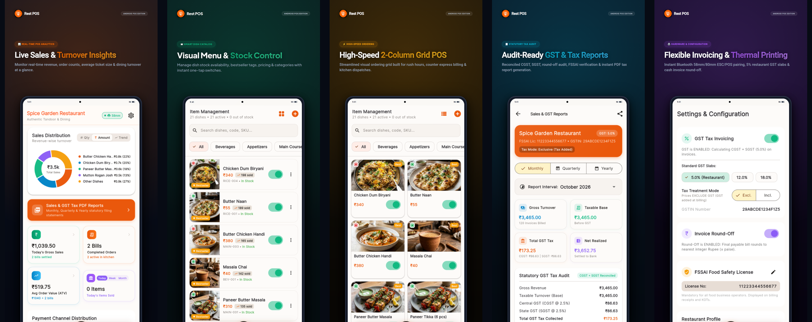
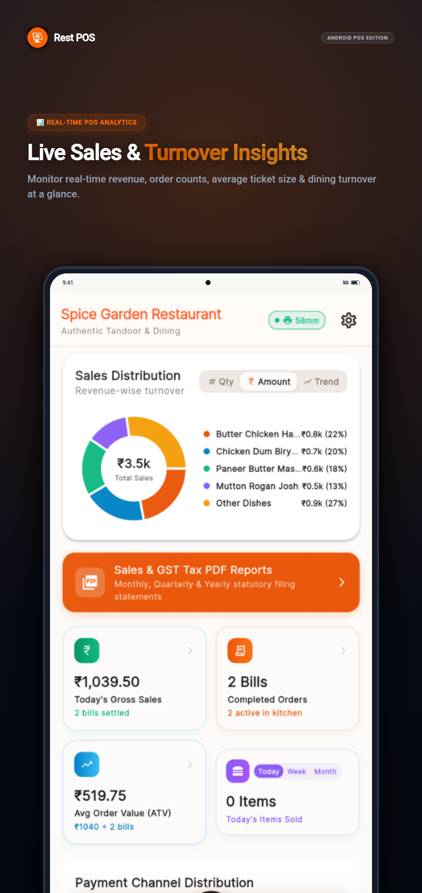
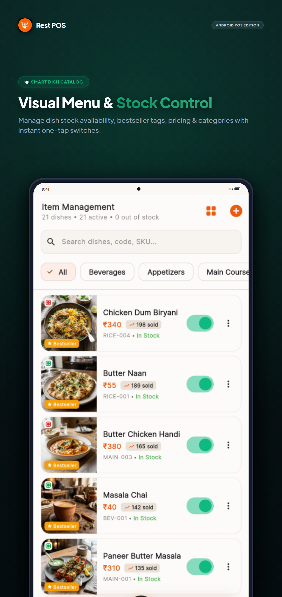
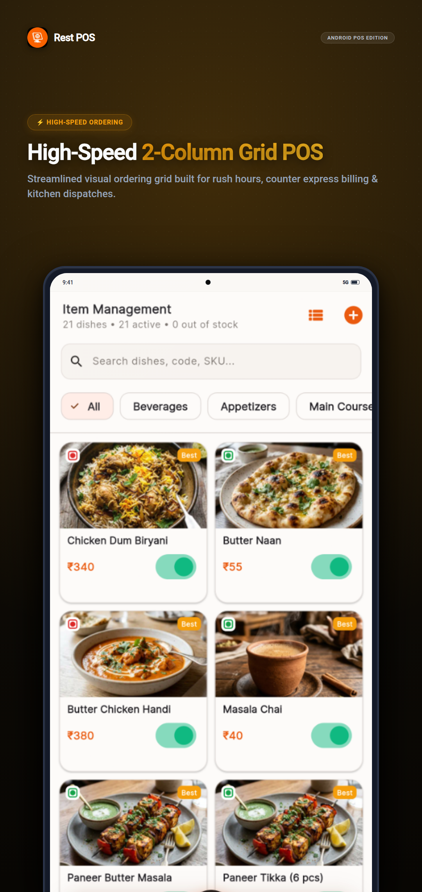
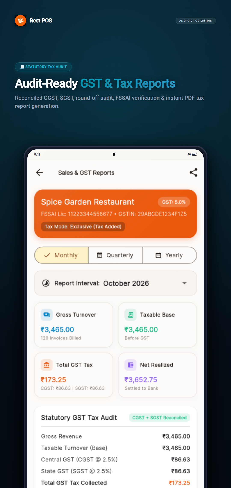
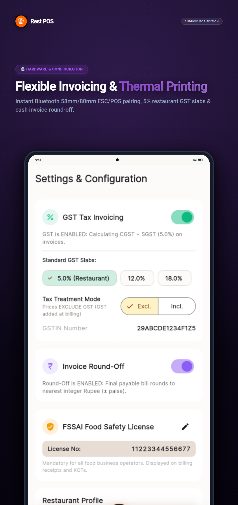
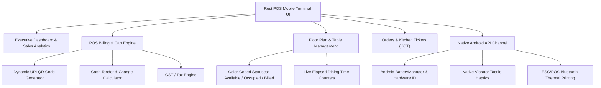

# 🍽️ Rest POS (Flutter & Material 3)

[](https://flutter.dev)
[](https://dart.dev)
[](https://m3.material.io)
[](https://android.com)
[](LICENSE)

<br/>

[](https://rookieenough.github.io/Orion-Data/app/?id=rest-pos)

A high-performance, **100% offline-first restaurant management and Point-of-Sale (POS)** application crafted with **Flutter**, **Dart**, and **Google Material 3 design**. Features buttery 60/120fps animations, tactile haptic feedback, real-time table floor plans with dining timers, dynamic UPI QR code payments, ESC/POS thermal printing hooks, and direct **native Android platform API integration**.

Designed for cafes, dine-in restaurants, quick-service eateries (QSR), cloud kitchens, and food trucks.

---

## 📱 App Screenshots Showcase



<p align="center">
  
  
  
  
  
</p>

---

## 🌟 Architecture & System Overview



---

## ✨ Key Features

### 1. 📊 Executive Dashboard & Circular Sales Analytics
- **Today's Gross Sales & Net Revenue**: Live metrics updated immediately upon each transaction.
- **Dynamic Circular Sales Chart (`fl_chart`)**: Interactive Donut/Pie sales distribution chart with toggle between `# Qty Sold` and `₹ Revenue Generated`.
- **Top-Selling Dishes Carousel**: Highlighting peak velocity items with dish photos, quantity counters, and total turnover.
- **Hourly Sales Velocity Chart**: Interactive trend graph powered by `fl_chart` to detect peak rush hours for kitchen staffing.
- **Dynamic Thermal Printer Status Badge**: Real-time printer status chip (`• 58mm Online` / `Offline`) with tap-to-reconnect toggle.
- **Hardware Telemetry**: Displays real-time device battery percentage, charging state, and Android OS version via native platform channels.

### 2. ⚡ High-Throughput POS Billing Engine & Tax Architecture
- **Visual Catalog & Instant Filters**: Filter dishes by category (`Beverages`, `Appetizers`, `Main Course`, `Breads & Rice`, `Desserts`) and dietary badges (**Veg 🟢**, **Non-Veg 🔴**, **Egg 🟡**).
- **Dual Operating Modes**:
  - **Dine-In Mode**: Seamless table assignment (`"Select Table"` bar) and floor plan integration.
  - **Takeaway Mode**: Counter billing with rapid checkout.
- **Cart Management & Precision Math**:
  - Integer paise precision to eliminate floating-point penny-rounding errors.
  - Line-item special kitchen notes and discount application.
- **Configurable Indian GST & Tax Modes**:
  - **Tax Inclusive (MRP-style)**: Product prices include 5% GST; automatic extraction of taxable base and CGST/SGST without inflating customer total.
  - **Tax Exclusive**: Calculates and appends CGST (2.5%) and SGST (2.5%) at checkout.
  - **GST Enable / Disable Toggle**: Easily switch off tax calculation for non-GST composite dealers.
  - **Automatic Invoice Round-Off**: Indian statutory nearest-rupee round-off calculation (`roundOffPaise`).
- **Multi-Tender Payment Settlement**:
  - **Dynamic Bharat UPI QR Code**: Encodes merchant VPA, bill amount down to the paise, and order reference into a standard on-screen QR code (scannable via Google Pay, PhonePe, Paytm, BHIM).
  - **Cash Tender Calculator**: Quick currency chips (`+₹100`, `+₹200`, `+₹500`, `+₹2000`) with automatic change-due calculations.
  - **Card / Ledger**: Instant settlement recording.

### 3. 🍲 Menu Item Management & Dynamic Catalog
- **Add New Items**: In-app modal dialog to register new dishes with name, category, price, and dietary type.
- **Context Actions (3-Dot Menu)**:
  - **Edit Dish**: Update dish names, pricing, and categories on the fly.
  - **Delete Dish**: Remove items with confirmation safeguards.
  - **Activate / Deactivate (Stock Toggle)**: Mark items out-of-stock with a clear dimmed visual overlay and disabled selection.
- **Auto-Collapsing Search Bar**: POS search bar dynamically collapses on scroll down and re-expands when scrolling back up.

### 4. 📑 Sales Analytics & Statutory GST PDF Reports
- **Multi-Period Aggregation**: Instant turnover summaries for **Monthly**, **Quarterly**, and **Yearly** reporting intervals.
- **Statutory Audit Breakdown**:
  - Taxable Gross Turnover vs Net Collections.
  - CGST (2.5%) and SGST (2.5%) audit reconciliation.
  - Average Order Value (AOV) and Order Count.
  - Tender breakdown (UPI vs Cash vs Card).
  - Category-wise turnover matrix.
- **Official A4 PDF Generator (`pdf` + `printing`)**:
  - One-tap generation of clean, printable tax invoices & audit reports.
  - Android system print spooler & share integration with direct thermal/desktop printer support.

### 5. 🪑 Visual Floor Plan & Table Management
- **Color-Coded Table Statuses**:
  - 🟢 **Available (Green)**: Ready for seating.
  - 🔵 **Occupied (Blue)**: Active dining session with unbilled orders.
  - 🟠 **Billed (Amber)**: Bill issued; awaiting settlement.
  - ⚫ **Reserved (Gray)**: Booked.
- **Live Elapsed Dining Timer**: Real-time counter showing elapsed dining minutes since order placement to monitor table turnover rate.
- **Table Operations**: Quick actions to seat guests, transfer active bills between tables, or free tables upon checkout.

### 6. 🧾 Orders Pipeline & Kitchen Tickets (KOT)
- Full lifecycle tracking: `Open` ➔ `Billed` ➔ `Paid` ➔ `Completed` (or `Cancelled`).
- Kitchen Order Ticket (KOT) formatting for 58mm and 80mm thermal printers.
- Detailed receipt modals with bill reprint capabilities.

### 7. 🎨 Material 3 Design & Buttery Animations
- **Material 3 Tonal Palette**: Expressive typography (`GoogleFonts.inter`), surface container elevations, and vibrant palette.
- **Floating FAB-Style Navigation Bar**: Sleek rounded-corner navigation dock with auto-hide behavior on scroll down.
- **Button Tap Bounce Animation (`BouncingButton`)**: Smooth scale-down spring physics (`Curves.easeInOutCubic` ➔ `Curves.easeOutBack`) accompanied by native tactile haptic feedback.
- **Screen Transitions (`SmoothPageRoute`)**: Fluid slide and fade animations when changing views.
- **Adaptive Layout**: Switches between bottom navigation on phones and lateral `NavigationRail` on tablets/countertop displays.

### 8. 📱 Native Android Platform API Integration
Built-in `MethodChannel` (`com.restaurantpos.app/native_channel`) in `MainActivity.kt`:
- `getDeviceInfo`: Device model, manufacturer, Android OS version, and hardware ID.
- `getBatteryInfo`: Android `BatteryManager` percentage and charging detection.
- `triggerHaptic`: Android `Vibrator` / `VibratorManager` tactile effects.
- `printReceipt`: Native ESC/POS thermal printing socket dispatch.
- `connectBluetoothPrinter` & `getPairedPrinters`: Direct Bluetooth thermal printer pairing and wireless ticket dispatch.
- `saveBackupToRestPos` & `readBackupFromRestPos`: Android MediaStore scoped-storage backup and restore.

---

## 🚀 Quick Start & Development

### 1. Clone the Repository
```bash
git clone https://github.com/your-username/flutter_restaurant_pos.git
cd flutter_restaurant_pos
```

### 2. Install Dependencies
```bash
flutter pub get
```

### 3. Analyze & Verify Code
```bash
flutter analyze
```

### 4. Run on Local Machine (Linux / Web / Android)
```bash
# Run on Linux Desktop
flutter run -d linux

# Run on Web (Chrome)
flutter run -d chrome

# Run on Connected Android Device (Wi-Fi or USB)
flutter run
```

---

## 📂 Project Structure

```
flutter_restaurant_pos/
├── lib/
│   ├── main.dart                          # App entry point & MultiProvider setup
│   ├── core/
│   │   ├── animations/
│   │   │   ├── bouncing_button.dart       # Tactile bounce/scale tap feedback
│   │   │   └── smooth_page_route.dart     # Easing curve screen transitions
│   │   ├── channels/
│   │   │   └── native_api_channel.dart    # Android MethodChannel client
│   │   ├── theme/
│   │   │   ├── app_theme.dart             # Material 3 light & dark themes
│   │   │   └── color_schemes.dart         # M3 Tonal color palettes
│   │   └── utils/
│   │       ├── currency_formatter.dart    # Indian currency (paise/₹) formatting
│   │       └── upi_helper.dart            # Dynamic Bharat UPI QR generator
│   ├── models/
│   │   ├── menu_category.dart             # Dish categories
│   │   ├── menu_item.dart                 # Menu items with dietary types
│   │   ├── order_model.dart               # Orders, lines, tax and tender
│   │   ├── restaurant_profile.dart        # Store info, GSTIN, FSSAI, UPI VPA
│   │   └── table_model.dart               # Floor plan tables and dining timers
│   ├── providers/
│   │   ├── menu_provider.dart             # Menu state & availability toggles
│   │   ├── order_provider.dart            # Order lifecycle & revenue stats
│   │   ├── pos_provider.dart              # Cart steppers, tax, and checkout
│   │   └── table_provider.dart            # Table seating & elapsed timers
│   ├── screens/
│   │   ├── home_shell_screen.dart         # Responsive M3 NavigationBar / NavigationRail
│   │   ├── dashboard/
│   │   │   └── dashboard_screen.dart      # Real-time analytics, charts, hardware info
│   │   ├── pos/
│   │   │   ├── pos_screen.dart            # Category filter, menu grid, cart sheet
│   │   │   └── payment_modal.dart         # UPI QR & Cash tender calculator
│   │   ├── tables/
│   │   │   └── tables_screen.dart         # Visual floor plan & table operations
│   │   ├── orders/
│   │   │   └── orders_screen.dart         # Orders list, KOT print, receipt reprint
│   │   └── settings/
│   │       └── settings_screen.dart       # Hardware, thermal printing & settings
│   └── widgets/
│       ├── animated_stat_card.dart        # Dashboard metric cards
│       ├── dietary_badge.dart             # Veg/Non-Veg/Egg emblems
│       └── upi_qr_widget.dart             # Live QR code renderer
├── app_screenshots/
│   ├── playstore_showcase/                # High-res marketing panorama & showcase cards
│   └── raw/                               # Raw full-device captures
├── android/
│   └── app/src/main/kotlin/com/restaurantpos/flutter_restaurant_pos/
│       └── MainActivity.kt                # Native Android MethodChannel handlers
├── pubspec.yaml
├── LICENSE                                # Apache 2.0
└── README.md
```

---

## 🤝 Contributing

Contributions, issues, and feature requests are welcome!
1. Fork the Project.
2. Create your Feature Branch (`git checkout -b feature/AmazingFeature`).
3. Commit your Changes (`git commit -m 'feat: add AmazingFeature'`).
4. Push to the Branch (`git push origin feature/AmazingFeature`).
5. Open a Pull Request.

---

## 📜 License

Distributed under the **Apache 2.0 License**. See [LICENSE](LICENSE) for more information.
